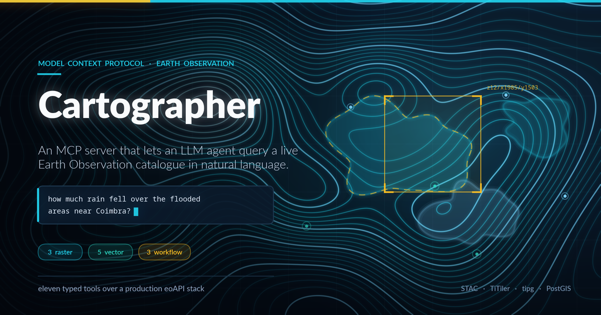

# Cartographer

[](https://github.com/lunasilvestre/cartographer/actions/workflows/ci.yml)
[](LICENSE)
[](https://www.python.org/)



**An MCP server that lets an LLM agent query a live Earth Observation catalogue in natural language — no geospatial code required.**

`eo-mcp` exposes eleven tools over a production [eoAPI](https://eoapi.dev/) stack (STAC + TiTiler + tipg). Ask *"how much rain fell over the flooded areas near Coimbra?"* and the agent finds the Copernicus EMS flood polygons, runs server-side zonal statistics against the ERA5 precipitation raster, and answers — without transferring a single pixel to the client.

The server does **zero** geospatial processing. It is a thin, typed proxy: all compute stays on the backend.

That example is not hypothetical. It is written up call by call, with real output, in
**[the worked example](docs/WORKED-EXAMPLE.md)** — including the mistake that makes the
same question return a confident, precise, completely wrong answer.

---

## Contents

| I want to… | Go to |
|---|---|
| See what this does, with real numbers | [Worked example](docs/WORKED-EXAMPLE.md) |
| Run it right now | [Try it in 60 seconds](#try-it-in-60-seconds) |
| Know what the tools do | [The eleven tools](#the-eleven-tools) · [full reference](servers/eo-mcp/README.md#tool-reference) |
| Point it at my own data | [Self-hosting](docs/SELF-HOSTING.md) |
| Understand the design | [ARCHITECTURE.md](ARCHITECTURE.md) |
| Contribute | [CONTRIBUTING.md](CONTRIBUTING.md) |
| Report a vulnerability | [SECURITY.md](SECURITY.md) |

---

## Try it in 60 seconds

The server is pre-configured against a **live public backend** at `api.cheias.pt` — real Copernicus EMS flood delineations and ERA5 meteorology from the February 2026 Portuguese floods. You don't need to deploy anything or clone this repo.

You'll need [uv](https://docs.astral.sh/uv/getting-started/installation/).

### Claude Code

```bash
claude mcp add eo-mcp -- uvx --from "git+https://github.com/lunasilvestre/cartographer.git#subdirectory=servers/eo-mcp" eo-mcp
```

### Claude Desktop

Add to `claude_desktop_config.json`:

```json
{
  "mcpServers": {
    "eo-mcp": {
      "command": "uvx",
      "args": [
        "--from",
        "git+https://github.com/lunasilvestre/cartographer.git#subdirectory=servers/eo-mcp",
        "eo-mcp"
      ]
    }
  }
}
```

Restart your client, then ask:

> Run a health check on the eo-mcp collections.

> What flood polygons are in `public.flood_extent_emsr864` around Coimbra, and how much rain fell over them?

> Give me a tile URL for the `precipitation-storm-total` item, and tell me what rescale it chose and why.

Prefer a local checkout? See [Development](#development).

> **The command above has been run against GitHub**, from an empty `UV_CACHE_DIR`
> so nothing was reused from a local build (2026-08-03). uv resolved the
> repository, built `eo-mcp` from the `servers/eo-mcp` subdirectory, installed 69
> packages, and the server completed an MCP `initialize` handshake over stdio and
> returned **exactly the eleven documented tools**, reporting itself as
> `eo-mcp 0.1.0`. That check is `.github/scripts/mcp_stdio_smoke.py`, the same
> script CI runs — point it at any server command:
>
> ```bash
> python .github/scripts/mcp_stdio_smoke.py --expect-version 0.1.0 \
>   uvx --from "git+https://github.com/lunasilvestre/cartographer.git#subdirectory=servers/eo-mcp" eo-mcp
> ```

### Check the backend without installing anything

The tools are proxies, so you can hit the same endpoints directly:

```bash
# 11 STAC collections. The limit matters — see the note below.
curl -s "https://api.cheias.pt/collections?limit=100" | jq -r '.collections[].id'

# 13 tipg collections (7 domain + 6 PostGIS utility tables)
curl -s "https://api.cheias.pt/vector/collections?f=json" | jq -r '.collections[].id'
```

> **Why `?limit=100`.** STAC pages at 10 by default and this catalogue has 11 collections,
> so a bare `curl .../collections` silently returns 10 and hides `wind-v`. The response
> tells you — `numberMatched: 11, numberReturned: 10` — but only if you look.

---

## The eleven tools

Signatures, parameters and return shapes are in the
**[full tool reference](servers/eo-mcp/README.md#tool-reference)**. This is the summary.

### Raster — TiTiler

| Tool | What it does |
|---|---|
| `get_raster_info` | Band count, dtype, CRS, bounds, nodata, pixel dimensions for a STAC item's asset. |
| `get_tile_url` | TileJSON + XYZ template. Picks a colormap and a rescale from STAC metadata when you don't, checking the values actually span the item's data, and reports which source won. |
| `get_zonal_statistics` | Mean/min/max/std/count/histogram/percentiles over a GeoJSON AOI. Categorical mode for classification rasters. |

### Vector — tipg / OGC API Features

| Tool | What it does |
|---|---|
| `list_vector_collections` | Available PostGIS collections with spatial and temporal extents. |
| `get_vector_features` | GeoJSON query with bbox, datetime, CQL2 filter, property selection, simplify, sortby, paging. |
| `get_vector_feature` | Single feature by `ogc_fid`. |
| `get_vector_tile_url` | TileJSON + a ready-to-use MapLibre GL style for MVT tiles. |
| `get_collection_queryables` | Filterable properties with JSON-schema types — lets an agent discover what it can filter on. |

### Workflows — composite

| Tool | What it does |
|---|---|
| `flood_rainfall_analysis` | Fetches flood polygons, computes precipitation stats per polygon, merges results back into each feature. |
| `multi_layer_summary` | Zonal statistics across several raster layers over one AOI, concurrently. |
| `collection_health_check` | Probes STAC and tipg backends, reports reachability and extent per collection. |

The workflow tools exist because chaining raster and vector calls by hand costs an agent three to five round trips and a lot of tokens. `flood_rainfall_analysis` collapses that into one call with bounded concurrency.

---

## Configuration

All optional — the defaults target the public demo backend.

| Variable | Default | Description |
|---|---|---|
| `EO_MCP_RASTER_URL` | `https://api.cheias.pt/raster` | TiTiler base URL |
| `EO_MCP_VECTOR_URL` | `https://api.cheias.pt/vector` | tipg (OGC Features) base URL |
| `EO_MCP_STAC_URL` | `https://api.cheias.pt` | STAC API base URL |
| `EO_MCP_AUTH_TOKEN` | *(empty)* | Bearer token, if your backend requires one |
| `EO_MCP_CONNECT_TIMEOUT` | `5.0` | Seconds allowed to establish a connection |
| `EO_MCP_REQUEST_TIMEOUT` | `30.0` | Seconds allowed for the response body |
| `EO_MCP_MAX_RETRIES` | `2` | Retries *after* the first attempt. `0` disables |
| `EO_MCP_RETRY_BACKOFF` | `0.5` | Exponential backoff base, seconds |
| `EO_MCP_MAX_CONCURRENCY` | `5` | Max in-flight requests per backend |

Copy [`.env.example`](.env.example) to `.env` and edit, or set them in your MCP client config.

The three URL settings are validated at startup, so a typo fails immediately with a
message naming the variable rather than surfacing later as a confusing connection error:

```
eo-mcp configuration is invalid:
  - EO_MCP_RASTER_URL is 'api.cheias.pt/raster', which has no URL scheme.
    Prefix it with https:// (or http:// for a local backend).
```

A trailing slash is normalised away rather than rejected, and `http://` is accepted
without complaint so you can point at a local backend.

---

## The demo backend

`api.cheias.pt` is a production eoAPI deployment — `stac-fastapi-pgstac` + `titiler-pgstac` + `tipg` behind nginx — built for [cheias.pt](https://github.com/lunasilvestre/cheias-pt), a study of the February 2026 Portuguese floods.

**STAC — 11 collections.** Nine carry raster assets under key `data`: `precipitation-daily`, `soil-moisture-daily`, `precondition`, `ivt`, `mslp`, `satellite-ir`, `sst-anomaly`, `wind-u`, `wind-v`. Two are vector-backed with no raster assets and link out to tipg: `flood-extent-emsr861`, `flood-extent-emsr864`.

**tipg — 13 collections, 7 of them domain data.** `public.flood_extent_emsr861`, `public.flood_extent_emsr864`, `public.frontal_boundaries`, `public.storm_tracks`, `public.discharge_stations`, `public.rivers_portugal`, `public.consequence_events`. The other six are PostGIS utility tables — `list_vector_collections` filters them out for you and reports them under `excluded_internal`, so the tools show 7 unless you ask for more. The `public.` prefix is required; the tools normalise a bare name.

Verified live on 2026-07-31. See the [self-hosting guide](docs/SELF-HOSTING.md) to point the
server at your own stack.

> **Availability.** This is a personal deployment offered for evaluation, not a service with an uptime commitment. There is no SLA, no support channel, and it may go away. Point the server at your own eoAPI stack if you need reliability.

> **Data licensing** is separate from this repo's Apache-2.0 code licence. Flood delineations are Copernicus EMS; meteorology is ERA5/NOAA. Check each source's terms before reuse.

---

## Design notes

**Why a proxy and not a geospatial library.** Handing an LLM `rasterio` means shipping data to the client and hoping the generated code is correct. Proxying TiTiler means the computation is a well-tested server-side operation and the agent only ever sees a small JSON result. Failure modes become HTTP status codes instead of silent numerical errors.

**No arbitrary URLs.** Every tool takes a `collection_id` / `item_id` and resolves against the configured backend. No tool accepts a caller-supplied URL, so pointing this at a backend doesn't hand callers an SSRF primitive. See [SECURITY.md](SECURITY.md).

**Discovery is somebody else's job.** `eo-mcp` complements [`stac-mcp`](https://github.com/BnJam/stac-mcp) rather than duplicating it: use stac-mcp to *find* items, eo-mcp to *analyse* them. See [docs/SIDEKICKS.md](docs/SIDEKICKS.md).

Fuller rationale in [ARCHITECTURE.md](ARCHITECTURE.md).

---

## Development

```bash
git clone https://github.com/lunasilvestre/cartographer.git
cd cartographer/servers/eo-mcp

uv sync --extra dev           # creates .venv from the committed uv.lock

uv run pytest -m "not slow"   # unit tests, no network
uv run ruff check src/ tests/
```

No `uv`? `python3 -m venv .venv && .venv/bin/pip install -e '.[dev]'` works too.

The full test matrix, the coverage floor, and what CI enforces are in
[CONTRIBUTING.md](CONTRIBUTING.md) — including one trap worth knowing before you
start: don't mix `uv pip install` with `uv run`.

Integration tests hit the live backend. They are skippable with
`EO_MCP_SKIP_INTEGRATION=1` and **never run in CI** — a backend outage must not turn the
build red.

`servers/eo-mcp/docs/` contains live-probed API notes for TiTiler and tipg, including six places where the real API diverges from its documentation. Worth reading before extending the tools.

---

## Repository layout

```
cartographer/
├── README.md                # you are here
├── ARCHITECTURE.md          # design rationale and taxonomy
├── CONTRIBUTING.md          # dev workflow, what CI enforces
├── SECURITY.md              # threat model, reporting
├── CHANGELOG.md
├── CLAUDE.md                # agent-facing instructions, not user docs
├── .github/
│   ├── workflows/           # ci.yml, release.yml
│   ├── scripts/             # mcp_stdio_smoke.py — asserts the 11-tool set
│   ├── ISSUE_TEMPLATE/
│   └── PULL_REQUEST_TEMPLATE.md
├── docs/
│   ├── WORKED-EXAMPLE.md    # a real question, real calls, real output
│   ├── SELF-HOSTING.md      # point it at your own eoAPI stack
│   └── SIDEKICKS.md         # complementary MCP servers
├── servers/eo-mcp/          # the MCP server
│   ├── README.md            # package README + full tool reference
│   ├── src/eo_mcp/
│   │   ├── server.py        # FastMCP entrypoint
│   │   ├── config.py        # pydantic-settings
│   │   └── tools/           # raster.py, vector.py, workflows.py
│   ├── tests/
│   └── docs/                # live-probed TiTiler + tipg API notes
└── prompts/                 # workflow recipes
    └── disaster/flood-extent.md
```

## Licence

Apache-2.0. See [LICENSE](LICENSE).
